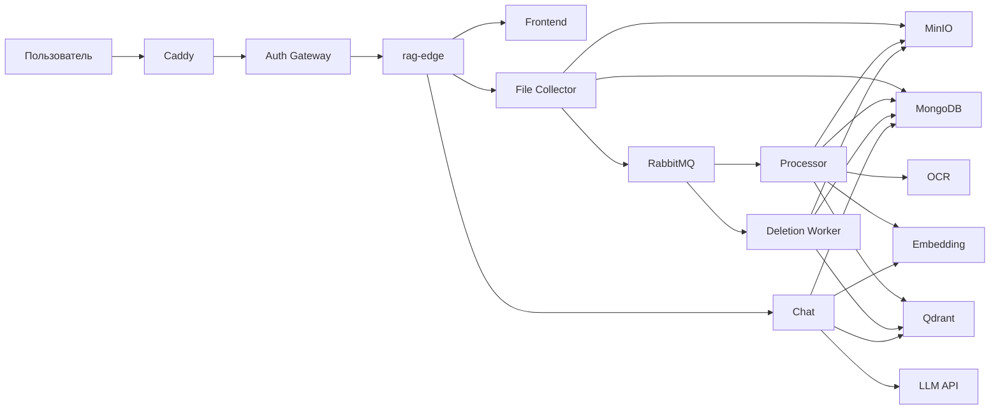

# Архитектура

## Репозиторий

Весь код RAG — один репозиторий: frontend, сервисы, воркеры, edge, compose и эта спецификация. Правила инструментов — в [../AGENTS.md](../AGENTS.md).

## Назначение

Система отвечает на вопросы по PDF-документам конкретного пользователя и показывает, из какого файла и с какой страницы взят фрагмент. Отдельно она регистрирует изображения этого пользователя и ищет их текстовым запросом в той же размерности эмбеддинга, без LLM и без OCR.

## Контекст

Caddy и Auth Gateway — существующие компоненты. Репозиторий их не содержит. В этом репозитории только `rag-edge`: он смотрит в сеть, к которой подключён gateway, и внутрь сети RAG. Контракт — [gateway.md](gateway.md).

## Компоненты

| Компонент | Тип | Обязанность |
|-----------|-----|-------------|
| Caddy | внешний | TLS. Один `reverse_proxy` на Auth Gateway. |
| Auth Gateway | внешний | Access JWT, маршрут хоста `rag.filenkov.store`, заголовки `X-Auth-*`. |
| rag-edge | FastAPI | Единственный процесс на сети `rag_edge`. Разводит `/api/files`, `/api/chats` и UI. |
| Frontend | Vite | Загрузка PDF, список, чат с режимом документов или изображений, предпросмотр PDF и показ изображения. Заголовки личности не ставит. |
| File Collector | FastAPI | Приём PDF, регистрация PDF и изображений по манифесту, список, метаданные, отдача байтов, постановка удаления. |
| Processor | Python-воркер | Чтение PDF, OCR, чанкинг, эмбеддинг текста в `documents`. Для изображения — один вектор в `images`, без OCR. Статус `ready` или `error`. |
| Deletion Worker | Python-воркер | Удаление объекта и точек в `documents` и `images`, статус `deleted`. |
| OCR | FastAPI | Одна страница-изображение → текст. Загруженные изображения пользователя сюда не приходят. |
| Embedding | FastAPI | Пачка текстов → векторы (`POST /embed`). Пачка изображений → векторы того же пространства (`POST /embed/image`). Рядом в том же контейнере llama-server считает вектор. |
| Chat | FastAPI | История, поиск по документам, поиск изображений, поток ответа. |
| LLM | внешний HTTP | OpenAI-совместимый `POST /chat/completions`. В режиме изображений не вызывается. |
| MinIO | инфраструктура | Байты PDF и байты изображений. |
| MongoDB | инфраструктура | Метаданные файлов, чаты, сообщения. |
| Qdrant | инфраструктура | Чанки PDF в `documents` и точки изображений в `images`. |
| RabbitMQ | инфраструктура | `doc.process` и `doc.delete`. |

Processor не вызывает LLM. Текст страницы хранится в `file_pages`, пока файл не удалён: это контрольная точка, а не отдельный поисковый индекс. PNG страницы не сохраняется.

## Доверие

File Collector и Chat считают `X-Auth-User-Id` уже проверенным Auth Gateway. Они не принимают логин, пароль, cookie и JWT и не выпускают сессии. `X-User-Id` не является идентификатором RAG.

Нет `X-Auth-User-Id` или это не UUID — `401`. `X-Auth-Role` со значением `BLOCKED` — `403`. Ресурс другого пользователя выглядит как `404`.

Сеть `rag_internal` не отдаётся наружу и не подключается к gateway. На сети `rag_edge` сидит только `rag-edge`; gateway подключается к ней, чтобы проксировать на edge. OCR и Embedding не проверяют пользователя: любой, кто до них достучится внутри `rag_internal`, может отправить текст. Снаружи этой сети их нет.

Секреты (`LLM_API_KEY`, ключи MinIO) приходят из окружения и не пишутся в логи.

## Поток загрузки

1. Auth Gateway передаёт загрузку на `rag-edge` с `X-Auth-User-Id`. Edge отдаёт её File Collector.
2. File Collector проверяет PDF, считает SHA-256, пишет объект в MinIO и документ `uploaded` в MongoDB.
3. Публикует `doc.process` и отвечает `202`.
4. Processor забирает одно сообщение, переводит файл в `processing`, строит чанки, пишет Qdrant и ставит `ready` либо `error`.
5. Клиент обновляет список, пока видит `uploaded`, `processing` или `deleting`.

Регистрация `POST /api/files/documents` и `POST /api/files/images` не кладёт новое тело в MinIO. File Collector проверяет ключ, делает `HEAD`, пишет `uploaded` и публикует тот же `doc.process`. PDF из манифеста идёт в прежний конвейер. Изображение Processor отдаёт в `POST /embed/image` и пишет одну точку в `images`. Word и обычный текст на регистрации документа получают `415` и в очередь не попадают. Multipart тоже разделён по конвейерам: `POST /api/files` принимает PDF, `POST /api/files/images` — изображение, и в этом случае байты пишутся в MinIO до публикации того же сообщения.

## Поток вопроса

1. Chat проверяет владельца чата и сохранять сообщение пока не начинает.
2. Embedding считает вектор вопроса.
3. Qdrant ищет ближайшие чанки с фильтром `user_id`.
4. Chat отбрасывает чанки, чей файл в MongoDB не в статусе `ready`.
5. Если чанков не осталось, в поток уходит фиксированная фраза без вызова LLM.
6. Иначе Chat вызывает LLM. Первое событие клиенту уже содержит источники. Если провайдер недоступен до первого текстового токена, дельт нет, ход всё равно завершается успехом с `finish_reason` `retrieval_only`. Иначе Chat стримит текст ответа.
7. После успешного завершения, включая `retrieval_only`, в MongoDB пишутся сообщение пользователя и ответ.

Режим `images` у того же маршрута сообщения LLM не вызывает. Вектор вопроса считается `POST /embed` с `input_type=query` и ищет коллекцию `images`. В поток уходит `meta` с массивом `images` и пустым `sources`, затем одна фраза `Найдено изображений: N.` или `Не найдено изображений.`

`GET /api/chats/image-search` использует тот же вектор и ту же коллекцию. Страницы одного запроса делят кэш вектора внутри процесса Chat.

## Поток удаления

1. File Collector условно переводит `uploaded`, `ready`, `error` или устаревший `processing` в `deleting` и публикует `doc.delete`. Свежий `processing` даёт `409`.
2. Deletion Worker удаляет объект MinIO, точки Qdrant в `documents` и в `images`, и только потом ставит `deleted`. Коллекции `images` нет — удаление всё равно доходит до `deleted`.
3. `ack` отправляется после этих трёх результатов. Ошибка любого шага — запись `error` не меняется на `deleted`, сообщение уходит в DLQ без повторной постановки в рабочую очередь.

`deleted` — надгробная запись. Документ MongoDB остаётся, чтобы повторное сообщение удаления завершилось без побочных эффектов и чтобы повторная загрузка того же содержимого была возможна: уникальность хеша на `deleted` не распространяется.

## Идемпотентность

Повторная доставка — нормальный режим RabbitMQ, а не ошибка.

- Повторный `doc.process` при `ready`, `deleting` или `deleted` подтверждается и не меняет хранилища.
- Повтор при `uploaded`, `error` или `processing` продолжает конвейер с последней записанной страницы и последней записанной пачки чанков. Готовые точки не стираются в начале прогона: идентификаторы стабильны, хвост старых чанков удаляется в конце.
- Повторный `doc.delete` при уже удалённых объекте и точках доводит запись до `deleted` и подтверждается.
- Условные переходы статуса не дают processor записать `ready` поверх `deleting`.

## Наблюдаемость

Каждый HTTP-сервис отдаёт `GET /health` без `X-Auth-User-Id`. Публичный `GET /health` хоста отвечает сам `rag-edge`.

Логи — JSON. В каждой записи, где значения известны: `service`, `request_id`, `message_id`, `file_id`, `user_id`, `chat_id`. Текст документов, байты PDF и изображений, промпт с контекстом и секреты в логи не попадают. На уровне `debug` допустим хеш и длины, но не сам текст.

Входящий `X-Request-Id` пробрасывается в исходящие HTTP-вызовы и в заголовок AMQP `x-request-id`. Если заголовка не было, сервис генерирует UUID и возвращает его в ответе.

Глубина `doc.processing.dead` и `doc.deletion.dead` — сигнал для внешнего мониторинга. Автоматического разбора DLQ нет.

## Сбой зависимостей

| Зависимость недоступна | Поведение |
|------------------------|-----------|
| MongoDB или MinIO на загрузке | `503`, объект и документ не оставлять в паре «есть только одно из двух», насколько это возможно: при ошибке MongoDB после успешного Put объект удаляется. Если удалить объект не удалось, факт пишется в лог. |
| RabbitMQ на публикации | Файл получает `error=enqueue_failed`, клиенту `500`. Sweeper позже публикует сообщение снова. |
| OCR одной страницы | Страница пропускается. Остальной документ обрабатывается. |
| Embedding или Qdrant в processor | `error`, сообщение в DLQ. Для изображения `502`/`504` эмбеддера сначала повторяются, как временный сбой; `400`, пустой вектор и неразобранные байты сразу дают `error=unsupported_image` и DLQ. |
| Коллекции `images` нет при удалении | Шаг пропускается. Остальные удаления продолжаются. |
| Embedding или Qdrant в чате | `503`, сообщения чата не создаются. |
| LLM недоступен до первого токена, источники есть | Один повтор. Затем SSE без дельт, `finish_reason` `retrieval_only`, оба сообщения сохраняются, `content` ответа пустой. |
| LLM оборвался после токена или вернул HTTP 4xx кроме 429 | Ошибка, сообщения чата не создаются. |
