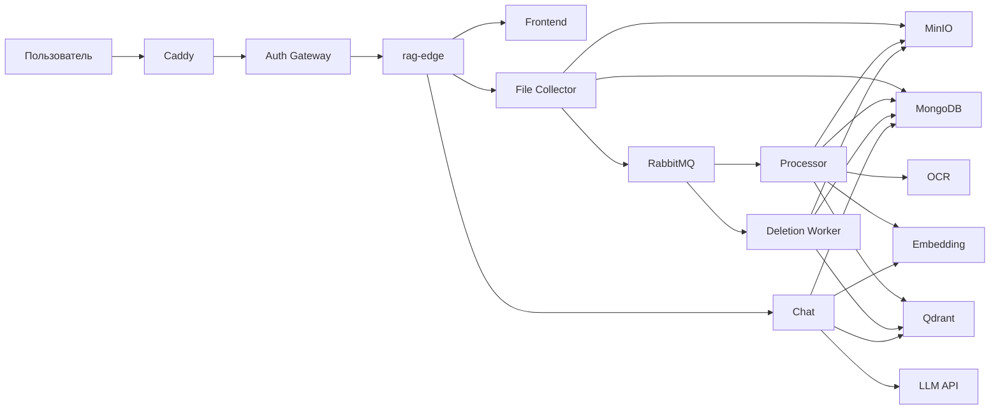

# Архитектура

## Назначение

Система отвечает на вопросы по PDF-документам конкретного пользователя и показывает, из какого файла и с какой страницы взят фрагмент.

## Контекст

Caddy и Auth Gateway — существующие компоненты. Репозиторий их не содержит. В этом репозитории только `rag-edge`: он смотрит в сеть, к которой подключён gateway, и внутрь сети RAG. Контракт — [gateway.md](gateway.md).

## Компоненты

| Компонент | Тип | Обязанность |
|-----------|-----|-------------|
| Caddy | внешний | TLS. Один `reverse_proxy` на Auth Gateway. |
| Auth Gateway | внешний | Access JWT, маршрут хоста `rag.filenkov.store`, заголовки `X-Auth-*`. |
| rag-edge | HTTP этого репозитория | Единственный процесс на сети `rag_edge`. Разводит `/api/files`, `/api/chats` и UI. |
| Frontend | клиент | Загрузка файлов, список, чат, предпросмотр PDF. Заголовки личности не ставит. |
| File Collector | HTTP | Приём PDF, список, метаданные, отдача байтов, постановка удаления. |
| Processor | consumer | Чтение PDF, OCR, чанкинг, эмбеддинг, запись в Qdrant, статус `ready` или `error`. |
| Deletion Worker | consumer | Удаление объекта и векторов, статус `deleted`. |
| OCR | внутренний HTTP | Одна страница-изображение → текст. |
| Embedding | внутренний HTTP | Пачка текстов → векторы. |
| Chat | HTTP | История, поиск, поток ответа. |
| LLM | внешний HTTP | OpenAI-совместимый `POST /chat/completions`. |
| MinIO | инфраструктура | Байты PDF. |
| MongoDB | инфраструктура | Метаданные файлов, чаты, сообщения. |
| Qdrant | инфраструктура | Чанки и векторы. |
| RabbitMQ | инфраструктура | `doc.process` и `doc.delete`. |

Processor не вызывает LLM. Текст страницы хранится в `file_pages`, пока файл не удалён: это контрольная точка, а не отдельный поисковый индекс. PNG страницы не сохраняется.

## Доверие

File Collector и Chat считают `X-Auth-User-Id` уже проверенным Auth Gateway. Они не принимают логин, пароль, cookie и JWT и не выпускают сессии. `X-User-Id` не является идентификатором RAG.

Нет `X-Auth-User-Id` или это не UUID — `401`. `X-Auth-Role` со значением `BLOCKED` — `403`. Ресурс другого пользователя выглядит как `404`.

Сеть `rag_internal` не отдаётся наружу и не подключается к gateway. На сети `rag_edge` сидит только `rag-edge`; gateway подключается к ней, чтобы проксировать на edge. OCR и Embedding не проверяют пользователя: любой, кто до них достучится внутри `rag_internal`, может отправить текст. Снаружи этой сети их нет.

Секреты (`LLM_API_KEY`, ключи MinIO) приходят из окружения и не пишутся в логи.

## Поток загрузки

1. Auth Gateway передаёт загрузку на `rag-edge` с `X-Auth-User-Id`. Edge отдаёт её File Collector.
2. File Collector проверяет PDF, считает SHA-256, пишет объект в MinIO и документ `uploaded` в MongoDB.
3. Публикует `doc.process` и отвечает `202`.
4. Processor забирает одно сообщение, переводит файл в `processing`, строит чанки, пишет Qdrant и ставит `ready` либо `error`.
5. Клиент обновляет список, пока видит `uploaded`, `processing` или `deleting`.

## Поток вопроса

1. Chat проверяет владельца чата и сохранять сообщение пока не начинает.
2. Embedding считает вектор вопроса.
3. Qdrant ищет ближайшие чанки с фильтром `user_id`.
4. Chat отбрасывает чанки, чей файл в MongoDB не в статусе `ready`.
5. Если чанков не осталось, в поток уходит фиксированная фраза без вызова LLM.
6. Иначе Chat стримит ответ LLM. Первое событие клиенту уже содержит источники.
7. После успешного завершения в MongoDB пишутся сообщение пользователя и ответ.

## Поток удаления

1. File Collector условно переводит `uploaded`, `ready`, `error` или устаревший `processing` в `deleting` и публикует `doc.delete`. Свежий `processing` даёт `409`.
2. Deletion Worker удаляет объект MinIO, точки Qdrant и только потом ставит `deleted`.
3. `ack` отправляется после этих трёх результатов. Ошибка любого шага — запись `error` не меняется на `deleted`, сообщение уходит в DLQ без повторной постановки в рабочую очередь.

`deleted` — надгробная запись. Документ MongoDB остаётся, чтобы повторное сообщение удаления завершилось без побочных эффектов и чтобы повторная загрузка того же содержимого была возможна: уникальность хеша на `deleted` не распространяется.

## Идемпотентность

Повторная доставка — нормальный режим RabbitMQ, а не ошибка.

- Повторный `doc.process` при `ready`, `deleting` или `deleted` подтверждается и не меняет хранилища.
- Повтор при `uploaded`, `error` или `processing` продолжает конвейер с последней записанной страницы и последней записанной пачки чанков. Готовые точки не стираются в начале прогона: идентификаторы стабильны, хвост старых чанков удаляется в конце.
- Повторный `doc.delete` при уже удалённых объекте и точках доводит запись до `deleted` и подтверждается.
- Условные переходы статуса не дают processor записать `ready` поверх `deleting`.

## Наблюдаемость

Каждый HTTP-сервис отдаёт `GET /health` без `X-Auth-User-Id`. Публичный `GET /health` хоста отвечает сам `rag-edge`.

Логи — JSON. В каждой записи, где значения известны: `service`, `request_id`, `message_id`, `file_id`, `user_id`, `chat_id`. Текст документов, байты PDF, промпт с контекстом и секреты в логи не попадают. На уровне `debug` допустим хеш и длины, но не сам текст.

Входящий `X-Request-Id` пробрасывается в исходящие HTTP-вызовы и в заголовок AMQP `x-request-id`. Если заголовка не было, сервис генерирует UUID и возвращает его в ответе.

Глубина `doc.processing.dead` и `doc.deletion.dead` — сигнал для внешнего мониторинга. Автоматического разбора DLQ нет.

## Сбой зависимостей

| Зависимость недоступна | Поведение |
|------------------------|-----------|
| MongoDB или MinIO на загрузке | `503`, объект и документ не оставлять в паре «есть только одно из двух», насколько это возможно: при ошибке MongoDB после успешного Put объект удаляется. Если удалить объект не удалось, факт пишется в лог. |
| RabbitMQ на публикации | Файл получает `error=enqueue_failed`, клиенту `500`. Sweeper позже публикует сообщение снова. |
| OCR одной страницы | Страница пропускается. Остальной документ обрабатывается. |
| Embedding или Qdrant в processor | `error`, сообщение в DLQ. |
| Embedding или Qdrant в чате | `503`, сообщения чата не создаются. |
| LLM | Один повтор. Затем ошибка потока, сообщения чата не создаются. |
