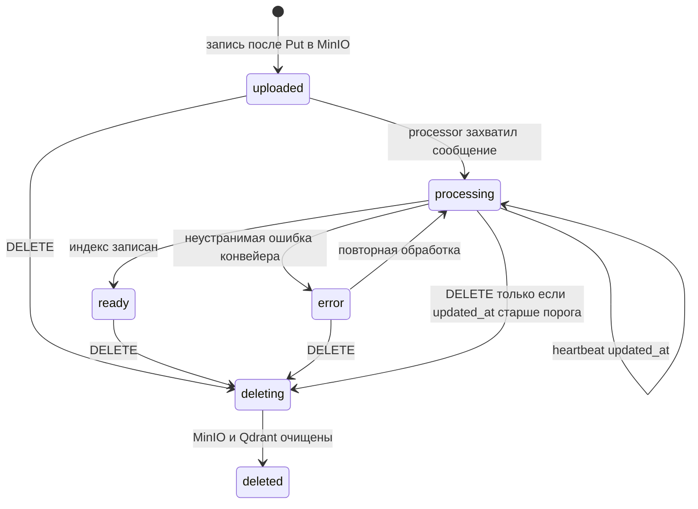

# Модели данных

База MongoDB задаётся путём в `MONGODB_URI` (по умолчанию база `rag`). Время хранится как BSON Date (UTC) и в API сериализуется как ISO-8601 с суффиксом `Z`. `_id` — внутренний ObjectId и в API не отдаётся.

Публичные идентификаторы — UUID версии 4, строкой в каноническом виде `8-4-4-4-12` в нижнем регистре.

## Статусы файла

Закрытый набор: `uploaded`, `processing`, `ready`, `error`, `deleting`, `deleted`.



| Из | В | Кто | Условие |
|----|---|-----|---------|
| `uploaded`, `error`, `processing` | `processing` | Processor | Документ ещё не `deleting`, `deleted` или `ready`. При входе `error` обнуляется. |
| `processing` | `ready` | Processor | Запись всё ещё `processing`. Пишутся `page_count` и `updated_at`. |
| `processing` | `error` | Processor | Пишется код в `error`. |
| `uploaded`, `ready`, `error` | `deleting` | File Collector | Условное обновление. Иначе `409` или `404`. |
| `processing` | `deleting` | File Collector | Только если `updated_at` старше `STALE_PROCESSING_SECONDS`. |
| `deleting` | `deleted` | Deletion Worker | После успеха MinIO и Qdrant. |

Других переходов нет. `ready` не возвращается в `processing` обычным путём: повторное сообщение при `ready` подтверждается без работы.

## Коллекция `files`

| Поле | Тип | Правило |
|------|-----|---------|
| `file_id` | string | UUID v4, уникальный. |
| `user_id` | string | UUID из `X-User-Id`. |
| `file_name` | string | Имя, как его показал пользователь, после отсечения пути. До 255 символов. |
| `safe_name` | string | Имя внутри `s3_key`. |
| `file_size` | int | Размер в байтах, больше 0. |
| `content_type` | string | Всегда `application/pdf`. |
| `content_sha256` | string | SHA-256 байтов файла, 64 hex-символа в нижнем регистре. |
| `s3_key` | string | `files/{user_id}/{file_id}/{safe_name}`. |
| `status` | string | Значение из закрытого набора. |
| `page_count` | int или null | Число страниц после успешного открытия PDF. До этого `null`. |
| `error` | string или null | Код ошибки либо `null`. |
| `delete_claimed_at` | datetime или null | Внутреннее поле. `null`, пока Deletion Worker не начал обработку. В API не отдаётся. |
| `created_at` | datetime | Момент вставки. |
| `updated_at` | datetime | Каждое изменение статуса и heartbeat. |

Коды `error`:

| Код | Когда |
|-----|--------|
| `corrupt_pdf` | Файл не открывается как PDF. |
| `storage_read_failed` | MinIO не отдал объект. |
| `embedding_failed` | Embedding не ответил после повторов. |
| `index_write_failed` | Qdrant не принял запись или предварительное удаление точек. |
| `metadata_update_failed` | Финальное обновление MongoDB не выполнено. |
| `no_extractable_text` | После извлечения и OCR не осталось ни одного чанка. |
| `enqueue_failed` | Публикация `doc.process` не подтвердилась. Повторно публикует только sweeper Processor. |

`safe_name`: взять базовое имя, оставить буквы Unicode, цифры и `._-`, остальные символы заменить на `_`, схлопнуть повторы `_`, обрезать до 200 символов, пустой результат заменить на `document.pdf`, расширение привести к `.pdf`.

Индексы, создаются идемпотентно при старте File Collector, Processor и Deletion Worker:

```javascript
db.files.createIndex({ file_id: 1 }, { unique: true })
db.files.createIndex({ user_id: 1, status: 1 })
db.files.createIndex({ user_id: 1, created_at: -1 })
db.files.createIndex(
  { user_id: 1, content_sha256: 1 },
  {
    unique: true,
    partialFilterExpression: {
      status: { $in: ["uploaded", "processing", "ready", "error", "deleting"] }
    }
  }
)
```

Частичный индекс разрешает заново загрузить тот же файл после `deleted`. Гонка двух одинаковых загрузок заканчивается ошибкой дубликата ключа у второй вставки; API отвечает `409 duplicate_file`.

В ответах API нет `s3_key`, `safe_name`, `content_sha256` и `user_id`.

## Коллекция `chats`

| Поле | Тип | Правило |
|------|-----|---------|
| `chat_id` | string | UUID v4, уникальный. |
| `user_id` | string | Владелец. |
| `title` | string | До первого сообщения — `Новый чат`. Затем обрезка текста первого вопроса. |
| `created_at` | datetime | |
| `updated_at` | datetime | Обновляется при новом завершённом ходе. |

Заголовок из вопроса: схлопнуть пробельные символы в один пробел, обрезать края, взять не больше 80 символов. Если обрезка прошла внутри строки, последние три символа результата — `...`. Пустым вопрос не бывает: API отклоняет пустую строку раньше.

Индексы, создаёт Chat при старте:

```javascript
db.chats.createIndex({ chat_id: 1 }, { unique: true })
db.chats.createIndex({ user_id: 1, updated_at: -1 })
```

## Коллекция `messages`

| Поле | Тип | Правило |
|------|-----|---------|
| `message_id` | string | UUID v4, уникальный. |
| `chat_id` | string | |
| `user_id` | string | Дублируется, чтобы выбирать сообщения только владельца. |
| `role` | string | `user` или `assistant`. |
| `content` | string | Текст сообщения. |
| `sources` | array | Только у `assistant`. У `user` поля нет. |
| `created_at` | datetime | У пары одного хода время ответа строго больше времени вопроса. |

Элемент `sources`:

| Поле | Тип | Правило |
|------|-----|---------|
| `file_id` | string | |
| `file_name` | string | Имя на момент ответа. Позже файл может быть удалён, имя в сообщении не переписывается. |
| `page_number` | int | Страница с 1, первый токен чанка. |
| `chunk_index` | int | С 0 внутри документа. |
| `snippet` | string | Начало `text` чанка. Если текст длиннее 500 символов, в snippet попадают первые 497 символов и `...`. |
| `score` | number | Оценка Qdrant, cosine similarity, больше — ближе. |

Индексы:

```javascript
db.messages.createIndex({ message_id: 1 }, { unique: true })
db.messages.createIndex({ chat_id: 1, created_at: 1 })
db.messages.createIndex({ user_id: 1, created_at: -1 })
```

Ход пишется только целиком: сначала документ `user`, затем `assistant`, затем `updated_at` чата. Если процесс упал между ними, при следующем чтении клиент может увидеть вопрос без ответа. Отдельной компенсации в MVP нет; повторный вопрос создаёт новый ход.

Коллекции настроек чата в MVP нет.

## Qdrant

Одна коллекция `documents` на всё приложение. Её создаёт Processor при старте, если коллекции ещё нет. Если коллекция есть, размерность вектора обязана совпасть с `EMBEDDING_DIM`. Иначе процесс не стартует.

Требуется Qdrant 1.11 или новее: флаг `is_tenant` появился в этой версии.

```python
client.create_collection(
    collection_name="documents",
    vectors_config=models.VectorParams(
        size=384,
        distance=models.Distance.COSINE,
    ),
    hnsw_config=models.HnswConfigDiff(
        payload_m=16,
        m=0,
    ),
)

client.create_payload_index(
    collection_name="documents",
    field_name="user_id",
    field_schema=models.KeywordIndexParams(
        type=models.KeywordIndexType.KEYWORD,
        is_tenant=True,
    ),
)

client.create_payload_index(
    collection_name="documents",
    field_name="document_id",
    field_schema=models.KeywordIndexParams(
        type=models.KeywordIndexType.KEYWORD,
    ),
)
```

`m=0` выключает общий граф. `payload_m=16` строит граф на каждого арендатора. Запрос без фильтра `user_id` по этой коллекции не выполняется: общий поиск по отключённому графу неполный.

### Идентификатор точки

```text
point_id = uuid5(namespace, "{file_id}:{chunk_index}")
```

`namespace` — UUID `a5b3c1d2-6e47-5f80-9c11-0d4e8f2a7b65`. Один и тот же чанк при повторе обработки получает тот же id и перезаписывается.

Перед upsert Processor удаляет все точки с этим `document_id` и `user_id`, затем пишет актуальный набор. Так сократившийся документ не оставляёт хвост старых чанков.

### Payload

| Поле | Тип | Правило |
|------|-----|---------|
| `text` | string | Текст чанка. |
| `document_id` | keyword | Равен `file_id`. |
| `user_id` | keyword | Арендатор. |
| `page_number` | integer | Страница первого токена, с 1. |
| `page_end` | integer | Страница последнего токена, с 1. |
| `file_name` | keyword | `file_name` на момент индексации. |
| `source` | keyword | `text` или `ocr`. |
| `chunk_index` | integer | С 0, без пропусков в записанном наборе. |
| `created_at` | string | ISO-8601, общее время индексации документа. |

`source = ocr`, если в окно попал хотя бы один токен со страницы, распознанной OCR. Иначе `text`.

### Поиск

```python
client.query_points(
    collection_name="documents",
    query=query_vector,
    query_filter=models.Filter(
        must=[
            models.FieldCondition(
                key="user_id",
                match=models.MatchValue(value=user_id),
            )
        ]
    ),
    limit=top_k,
)
```

`top_k` берётся из `RAG_TOP_K`. Фильтра по конкретному файлу в MVP нет.

Если задан `RAG_MIN_SCORE` больше 0, точки с оценкой ниже порога отбрасываются. Порог сравнивается с cosine similarity, которую возвращает Qdrant.

### Удаление точек файла

```python
client.delete(
    collection_name="documents",
    points_selector=models.FilterSelector(
        filter=models.Filter(
            must=[
                models.FieldCondition(
                    key="user_id",
                    match=models.MatchValue(value=user_id),
                ),
                models.FieldCondition(
                    key="document_id",
                    match=models.MatchValue(value=file_id),
                ),
            ]
        )
    ),
)
```

Успех операции при нуле удалённых точек — нормальный результат.

## Объект в MinIO

Бакет — `S3_BUCKET` (по умолчанию `documents`). Один объект на файл, ключ `s3_key`. File Collector создаёт бакет при старте, если его нет.

Содержимое — исходные байты PDF. Производные изображения страниц не сохраняются.
